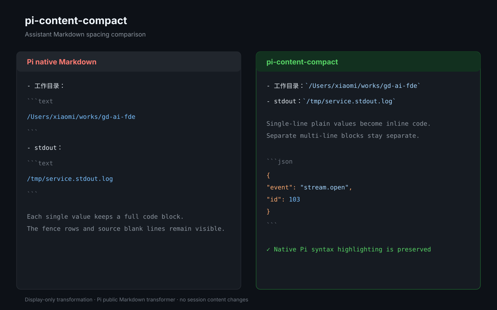

# pi-content-compact

`pi-content-compact` is a small Pi package that makes assistant Markdown easier to scan while preserving separate code blocks and Pi's native syntax highlighting.



## Key features

- **Assistant-only display** — changes terminal presentation without modifying session files, model context, exports, or original messages.
- **Compact single-line values** — turns path, command, PID, and log values in complete single-line fences into inline code.
- **Fence-free code blocks** — hides ` ```json `, ` ```text `, and similar wrapper rows while preserving separate blocks and Pi's native syntax highlighting.
- **Safe private patch** — wraps `Markdown.prototype.renderToken` only for assistant content, restores the original renderer on shutdown/reload, and falls back gracefully when Pi changes its internals.
- **Small, focused package** — uses no runtime dependencies and does not replace tools, Bash, header, footer, or editor rendering.

For example, this assistant output:

````markdown
- 工作目录：

  ```text
  /Users/xiaomi/works/gd-ai-fde
  ```

- stdout：

  ```text
  /tmp/service.stdout.log
  ```
````

is displayed as:

````markdown
- 工作目录：`/Users/xiaomi/works/gd-ai-fde`
- stdout：`/tmp/service.stdout.log`
````

Multi-line blocks remain separate and keep their language-aware highlighting. Their wrapper rows are hidden in the terminal display:

````markdown
```json
{
  "event": "stream.open",
  "id": 103
}
```
````

The source remains unchanged; only the assistant transcript presentation is compacted.

## Install from GitHub

```bash
pi install git:github.com/laoshu133/pi-content-compact
```

After updating the package while Pi is running, use `/reload`.

For local development:

```bash
pi install .
npm test
npm run check
```

The package is discovered through [`package.json`](package.json), which exposes `extensions/pi-content-compact.ts` as its Pi extension entry point.
